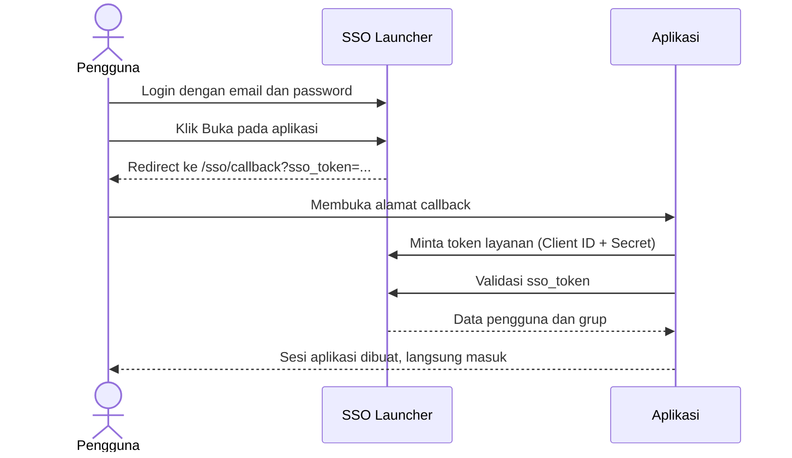

# SSO Launcher

Portal login tunggal (SSO) dan peluncur aplikasi: pengguna cukup masuk sekali, lalu membuka semua aplikasi yang diizinkan tanpa login ulang. Akses diatur lewat grup, dan setiap perubahan tercatat lengkap di audit trail.


## Daftar Isi

- [Fitur](#fitur)
- [Cara Kerja SSO](#cara-kerja-sso)
- [Tech Stack](#tech-stack)
- [Memulai](#memulai)
- [Konfigurasi](#konfigurasi)
- [Perintah](#perintah)
- [Struktur Proyek](#struktur-proyek)
- [Hak Akses](#hak-akses)
- [Dokumentasi](#dokumentasi)
- [Kontribusi](#kontribusi)
- [Lisensi](#lisensi)
- [Pembuat](#pembuat)

## Fitur

| Fitur | Deskripsi |
| --- | --- |
| Login dan sesi | Masuk dengan email dan password. Sesi disimpan di cookie HTTP-only, dilindungi CSRF, dengan batas percobaan login per IP dan per akun |
| Application launcher | Halaman Beranda, Aplikasi Saya, Favorit, dan Terbaru untuk menemukan dan membuka aplikasi yang boleh diakses |
| SSO | Token peluncuran berumur 60 detik dan sekali pakai, divalidasi aplikasi tujuan secara server-to-server dengan kredensial layanan |
| Akses berbasis grup | Menu, aksi per tombol, dan aplikasi diberikan lewat grup pengguna per departemen. Nama grup ikut dikirim ke aplikasi tujuan |
| Sesi lintas aplikasi | Aplikasi memeriksa sesi portal secara berkala. Logout di portal mengakhiri sesi semua aplikasi |
| Panduan integrasi | Setiap kredensial SSO menghasilkan file panduan siap pakai berisi Client ID, Client Secret, pengaturan, dan contoh kode untuk 8 bahasa/framework |
| Menu bertingkat | Menu sidebar boleh bertingkat, bisa diurutkan dengan drag and drop, dan bisa ditandai sedang perbaikan |
| Notifikasi | Pemberitahuan login dari perangkat baru dan akun terkunci |
| Audit trail | Soft delete dengan alasan wajib, histori perubahan per field, versi data dengan rollback, dan pencatatan IP, perangkat, sistem operasi, serta browser |
| Riwayat aktivitas | Pusat audit dengan filter, detail perubahan, tempat sampah, dan ekspor Excel |
| Tampilan | Tema terang dan gelap, responsif dengan menu bawah di HP |

## Cara Kerja SSO



Detail endpoint, format data, dan contoh kode ada di [panduan integrasi SSO](docs/SSO-INTEGRATION.md).

## Tech Stack

| Lapisan | Teknologi |
| --- | --- |
| Frontend | Next.js 16 (App Router), React 19, TypeScript, Zod |
| Backend | ASP.NET Core Minimal API (.NET 10) dengan arsitektur Domain, Application, dan Infrastructure |
| ORM | Entity Framework Core + Npgsql, migrasi code-first |
| Database | PostgreSQL 16 atau lebih baru |
| Tes | xUnit v3 + WebApplicationFactory dengan database PostgreSQL terpisah, Vitest untuk frontend |
| Lainnya | ClosedXML (ekspor Excel), Scalar (dokumentasi API di Development), pnpm workspace |

## Memulai

### Prasyarat

- [.NET 10 SDK](https://dotnet.microsoft.com/download) dan `dotnet-ef` (`dotnet tool install --global dotnet-ef`)
- [Node.js](https://nodejs.org/) 24 dan [pnpm](https://pnpm.io/) 10
- [PostgreSQL](https://www.postgresql.org/) 16 atau lebih baru

### Instalasi

1. Clone repository dan pasang dependensi.

   ```bash
   git clone https://github.com/fedyfsgerana/sso-launcher.git
   cd sso-launcher
   pnpm install
   dotnet restore apps/api/SsoLauncher.Api.csproj
   ```

2. Buat database.

   ```sql
   CREATE DATABASE sso_launcher;
   ```

3. Salin konfigurasi contoh, lalu isi password database dan dua signing key acak (lihat [Konfigurasi](#konfigurasi)).

   ```bash
   cp apps/api/appsettings.Development.example.json apps/api/appsettings.Development.json
   cp apps/web/.env.example apps/web/.env.local
   ```

4. Jalankan API. Di mode Development, migrasi dan data awal dijalankan otomatis.

   ```bash
   dotnet run --project apps/api/SsoLauncher.Api.csproj
   ```

5. Di terminal lain, jalankan web.

   ```bash
   pnpm --prefix apps/web dev
   ```

Buka `http://localhost:3000` dan masuk dengan `administrator@example.com` / `p@ssw0rd`. Akun ini hanya dibuat di mode Development.

| Layanan | Alamat |
| --- | --- |
| Web | `http://localhost:3000` |
| API | `http://localhost:5000` |
| Dokumentasi API (Scalar) | `http://localhost:5000/scalar` |
| Health check | `http://localhost:5000/health` |

## Konfigurasi

Di Development, API membaca `apps/api/appsettings.Development.json`. Di server, nilai yang sama diisi lewat environment variable, misalnya `ConnectionStrings__PostgreSql`.

| Kunci | Keterangan |
| --- | --- |
| `ConnectionStrings:PostgreSql` | Koneksi PostgreSQL, misalnya `Host=127.0.0.1;Port=5432;Database=sso_launcher;Username=postgres;Password=...` |
| `SsoToken:SigningKey` | Kunci penanda tangan token SSO, minimal 32 byte acak |
| `ServiceAccessToken:SigningKey` | Kunci token antar-layanan, minimal 32 byte acak dan berbeda dari kunci SSO |
| `Cors:AllowedOrigins` | Alamat web yang boleh memanggil API |
| `Bootstrap:Email`, `Bootstrap:Password` | Akun administrator pertama di produksi, hanya dipakai saat database masih kosong |
| `NEXT_PUBLIC_API_URL` | Alamat API untuk frontend, di `apps/web/.env.local` |

Membuat signing key acak:

```bash
openssl rand -base64 48
```

Di Windows PowerShell:

```powershell
$bytes = New-Object byte[] 48
[Security.Cryptography.RandomNumberGenerator]::Create().GetBytes($bytes)
[Convert]::ToBase64String($bytes)
```

Daftar lengkap pengaturan ada di [SETUP](docs/SETUP.md) dan [DEPLOYMENT](docs/DEPLOYMENT.md).

## Perintah

| Perintah | Fungsi |
| --- | --- |
| `pnpm --prefix apps/web dev` | Menjalankan web |
| `pnpm --prefix apps/web lint` | Pemeriksaan ESLint |
| `pnpm --prefix apps/web typecheck` | Pemeriksaan tipe TypeScript |
| `pnpm --prefix apps/web test` | Tes Vitest |
| `pnpm --prefix apps/web build` | Build produksi web |
| `dotnet run --project apps/api/SsoLauncher.Api.csproj` | Menjalankan API |
| `dotnet test --project apps/api/tests/SsoLauncher.Api.Tests/SsoLauncher.Api.Tests.csproj` | Tes API, butuh `SSO_LAUNCHER_TEST_DB_CONNECTION` |
| `dotnet ef migrations add <Nama> ...` | Membuat migrasi baru, perintah lengkapnya di [database/README.md](database/README.md) |

## Struktur Proyek

```text
sso-launcher/
├── apps/
│   ├── api/                          # Backend ASP.NET Core
│   │   ├── Endpoints/                # Definisi endpoint API
│   │   ├── OpenApi/Contracts/        # Kontrak OpenAPI
│   │   ├── src/
│   │   │   ├── SsoLauncher.Domain/          # Entity dan konstanta
│   │   │   ├── SsoLauncher.Application/     # Use case dan service
│   │   │   └── SsoLauncher.Infrastructure/  # EF Core, migrasi, seeder, keamanan
│   │   └── tests/SsoLauncher.Api.Tests/     # Tes integrasi API
│   └── web/                          # Frontend Next.js
│       └── src/
│           ├── app/                  # Route
│           ├── components/           # Komponen halaman dan UI
│           ├── features/             # Pemanggilan API dan logika per fitur
│           ├── lib/                  # Utilitas dan skema bersama
│           └── styles/               # CSS global
├── database/                         # Panduan database dan skrip reset data dev
└── docs/                             # Dokumentasi
```

## Hak Akses

SSO Launcher tidak memakai peran. Semua hak akses datang dari **grup**: menu yang dimiliki grup menentukan halaman yang tampil di sidebar, dan endpoint API memeriksa menu yang sama di server. Selain menu, setiap grup mencentang **aksi** yang boleh dipakai, misalnya Tambah, Hapus, atau Ekspor.

| Halaman | Isi |
| --- | --- |
| Manajemen Pengguna | Pengguna dan keamanan akun |
| Manajemen Grup & Akses | Grup, anggota, akses aplikasi, dan akses menu |
| Manajemen Aplikasi | Aplikasi, pengguna aplikasi, dan kredensial SSO |
| Manajemen Menu | Menu sidebar, urutan, dan mode perbaikan |
| Riwayat Aktivitas | Aktivitas, histori versi, rollback, dan tempat sampah |

Grup **Administrator** bawaan memegang seluruh menu beserta semua aksinya.

## Dokumentasi

| Dokumen | Isi |
| --- | --- |
| [SETUP](docs/SETUP.md) | Instalasi lengkap dan penyelesaian masalah umum |
| [Dokumentasi Teknis](docs/README.md) | Arsitektur, autentikasi, model akses, dan audit trail |
| [SSO-INTEGRATION](docs/SSO-INTEGRATION.md) | Cara menghubungkan aplikasi lain ke SSO Launcher, dengan contoh kode |
| [USER-MANUAL](docs/USER-MANUAL.md) | Panduan pemakaian untuk pengguna dan pengelola portal |
| [WORKFLOW](docs/WORKFLOW.md) | Alur kerja: aplikasi baru, pengguna baru, pemakaian harian, dan audit |
| [DEPLOYMENT](docs/DEPLOYMENT.md) | Menjalankan SSO Launcher di server |
| [RUNBOOK](docs/RUNBOOK.md) | Penanganan gangguan dan perawatan rutin |
| [SECURITY](docs/SECURITY.md) | Spesifikasi keamanan |
| [Database](database/README.md) | Migrasi, backup, reset, dan konvensi penamaan |
| [CHANGELOG](CHANGELOG.md) | Riwayat perubahan |

## Kontribusi

Kontribusi terbuka. Baca [CONTRIBUTING](CONTRIBUTING.md) sebelum membuat Pull Request.

## Lisensi

Dirilis dengan lisensi [MIT](LICENSE).

## Pembuat

**Fedy Fs. Gerana** — Full-stack Developer

- GitHub: [@fedyfsgerana](https://github.com/fedyfsgerana)
